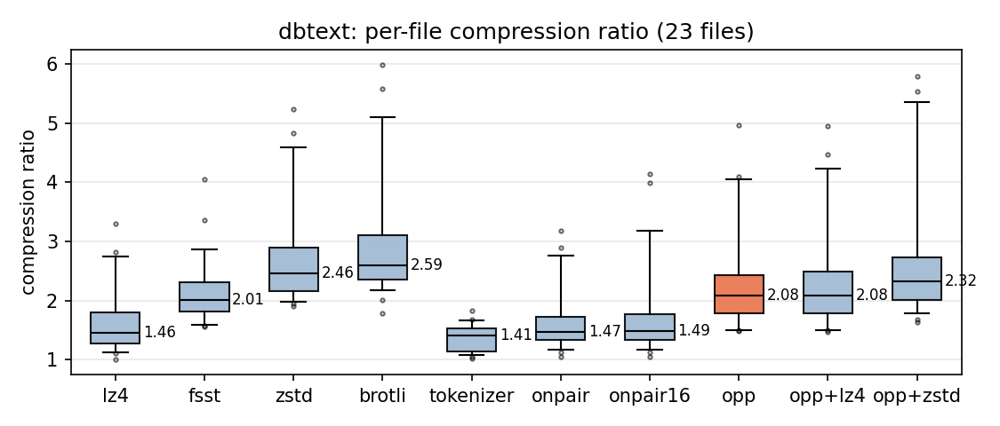
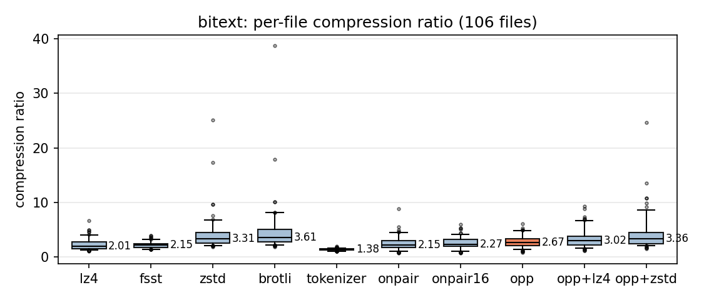
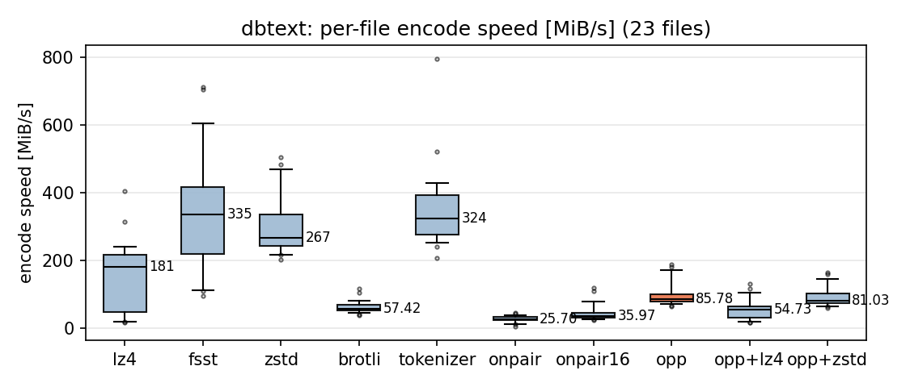
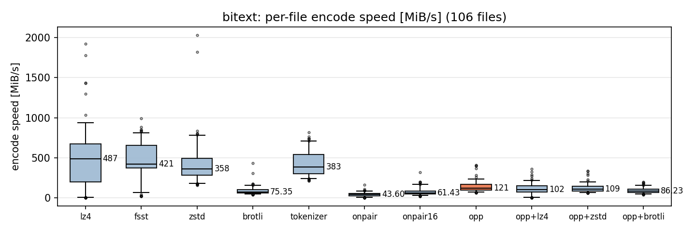
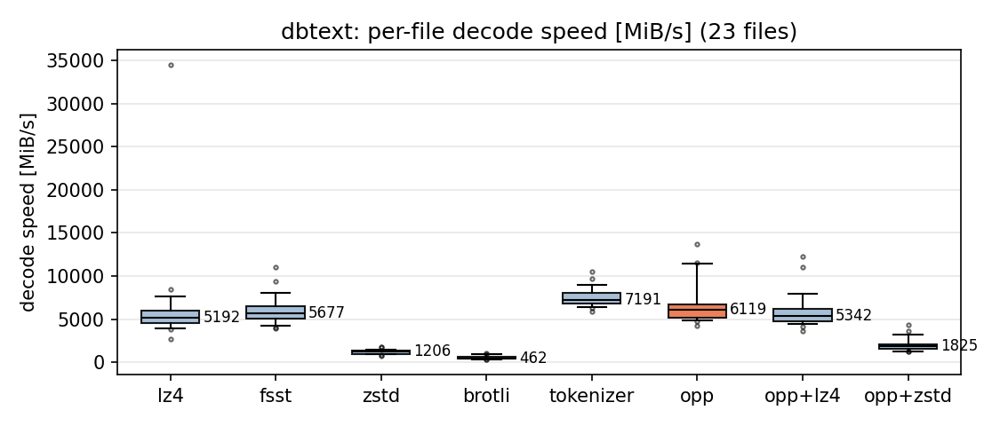
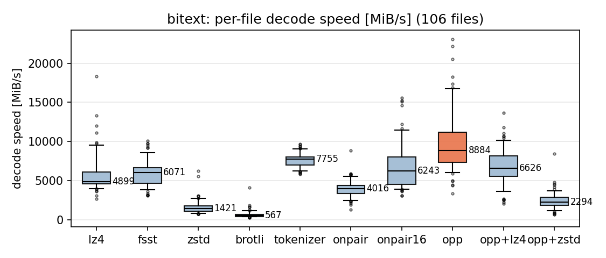

# OnPairPlus

A standalone, dependency-free implementation of **OnPair+**, a dictionary-based string compressor
optimized for very fast decompression at compression ratios close to zstd.

## The algorithm

**OnPair** trains a dictionary of up to 65,536 symbols (each at most 16 bytes) in a *single
streaming pass*: the input is scanned with greedy longest-prefix matching against the current
dictionary, adjacent match pairs are counted, and once a pair reaches a frequency threshold it is
merged into a new symbol that is immediately available for further matching (an online variant of
byte-pair encoding). The compressed stream is simply a sequence of 16-bit token ids; decompression
is a table lookup plus a 16-byte store per token, which makes it extremely fast.

**OnPair+** adds three ideas on top:

- **N-gram seeding**: the token ids left over after training are filled with *all* K^n combinations
  of the K most frequent characters, for n = 2, 3, 4. Text the dictionary does not cover then costs
  one token per n bytes instead of one per byte. A level is stored as a 32-byte character bitmap
  whatever its size, and the decoder re-enumerates it.
- **Hybrid dictionary serialization**: symbols of 2..4 bytes are stored raw, longer ones as the two
  parent ids they were merged from. Parents always precede their children, so the decoder rebuilds
  the table by concatenation, and a 16-byte symbol costs 4 bytes to store rather than 16.
- **Adaptive token id width**: with at most 4,096 tokens the ids fit in 12 bits instead of 16, but
  the smaller table matches less and so emits more of them. Which trade wins depends on the data,
  so both dictionaries are built and the one spending fewer bits is kept. The width is not stored;
  the decoder infers it from the dictionary size.

## Results

Apple M-class laptop, single-threaded, in-memory; dbtext best-of-10, bitext and enwik9 best-of-3.
Levels: lz4 default, zstd -3, brotli -q 5. **dbtext** (database string columns, 38 MiB) and
**bitext** (text columns from table public, 12.7 GiB) report per-file medians; **enwik9** (English
Wikipedia) is one 1 GB file. `onpair`/`onpair16` are the reference implementation this one descends
from and `tokenizer` a training-free fixed token table; see [Benchmark](#benchmark) for both.

<table>
<tr>
<td valign="top">

<table>
<tr><th colspan="4" align="center">dbtext (23 files)</th></tr>
<tr><th align="left">compressor</th><th align="right">ratio</th><th align="right">enc<br>MiB/s</th><th align="right">dec<br>MiB/s</th></tr>
<tr><td>lz4</td><td align="right">1.46</td><td align="right">178</td><td align="right">4745</td></tr>
<tr><td>fsst</td><td align="right">2.01</td><td align="right">330</td><td align="right">5489</td></tr>
<tr><td>zstd</td><td align="right">2.46</td><td align="right">277</td><td align="right">1083</td></tr>
<tr><td>brotli</td><td align="right">2.59</td><td align="right">56</td><td align="right">438</td></tr>
<tr><td>tokenizer</td><td align="right">1.41</td><td align="right">341</td><td align="right">7091</td></tr>
<tr><td>onpair</td><td align="right">1.47</td><td align="right">25</td><td align="right">4496</td></tr>
<tr><td>onpair16</td><td align="right">1.49</td><td align="right">36</td><td align="right">5581</td></tr>
<tr><td><b>opp</b></td><td align="right"><b>2.33</b></td><td align="right"><b>76</b></td><td align="right"><b>8447</b></td></tr>
<tr><td>opp+lz4</td><td align="right">2.32</td><td align="right">50</td><td align="right">6649</td></tr>
<tr><td>opp+zstd</td><td align="right">2.45</td><td align="right">72</td><td align="right">2405</td></tr>
<tr><td>opp+brotli</td><td align="right">2.51</td><td align="right">58</td><td align="right">540</td></tr>
</table>

</td>
<td valign="top">

<table>
<tr><th colspan="4" align="center">bitext (106 files)</th></tr>
<tr><th align="left">compressor</th><th align="right">ratio</th><th align="right">enc<br>MiB/s</th><th align="right">dec<br>MiB/s</th></tr>
<tr><td>lz4</td><td align="right">2.01</td><td align="right">487</td><td align="right">4764</td></tr>
<tr><td>fsst</td><td align="right">2.15</td><td align="right">421</td><td align="right">5901</td></tr>
<tr><td>zstd</td><td align="right">3.31</td><td align="right">358</td><td align="right">1337</td></tr>
<tr><td>brotli</td><td align="right">3.61</td><td align="right">75</td><td align="right">529</td></tr>
<tr><td>tokenizer</td><td align="right">1.38</td><td align="right">383</td><td align="right">7469</td></tr>
<tr><td>onpair</td><td align="right">2.15</td><td align="right">44</td><td align="right">3780</td></tr>
<tr><td>onpair16</td><td align="right">2.27</td><td align="right">61</td><td align="right">5700</td></tr>
<tr><td><b>opp</b></td><td align="right"><b>2.67</b></td><td align="right"><b>121</b></td><td align="right"><b>8361</b></td></tr>
<tr><td>opp+lz4</td><td align="right">3.02</td><td align="right">102</td><td align="right">6066</td></tr>
<tr><td>opp+zstd</td><td align="right">3.36</td><td align="right">109</td><td align="right">2161</td></tr>
<tr><td>opp+brotli</td><td align="right">3.47</td><td align="right">86</td><td align="right">607</td></tr>
</table>

</td>
<td valign="top">

<table>
<tr><th colspan="4" align="center">enwik9 (1 file)</th></tr>
<tr><th align="left">compressor</th><th align="right">ratio</th><th align="right">enc<br>MiB/s</th><th align="right">dec<br>MiB/s</th></tr>
<tr><td>lz4</td><td align="right">1.96</td><td align="right">692</td><td align="right">4769</td></tr>
<tr><td>fsst</td><td align="right">1.65</td><td align="right">416</td><td align="right">4258</td></tr>
<tr><td>zstd</td><td align="right">3.21</td><td align="right">320</td><td align="right">1216</td></tr>
<tr><td>brotli</td><td align="right">3.60</td><td align="right">78</td><td align="right">572</td></tr>
<tr><td>tokenizer</td><td align="right">1.63</td><td align="right">248</td><td align="right">8053</td></tr>
<tr><td>onpair</td><td align="right">2.83</td><td align="right">103</td><td align="right">4171</td></tr>
<tr><td>onpair16</td><td align="right">2.75</td><td align="right">116</td><td align="right">4907</td></tr>
<tr><td><b>opp</b></td><td align="right"><b>2.82</b></td><td align="right"><b>218</b></td><td align="right"><b>9475</b></td></tr>
<tr><td>opp+lz4</td><td align="right">3.22</td><td align="right">200</td><td align="right">5414</td></tr>
<tr><td>opp+zstd</td><td align="right">3.50</td><td align="right">170</td><td align="right">1835</td></tr>
<tr><td>opp+brotli</td><td align="right">3.52</td><td align="right">111</td><td align="right">639</td></tr>
</table>

</td>
</tr>
</table>

opp decompresses fastest of the whole field on all three corpora — ahead of even the training-free
tokenizer, which bounds how fast a 16-bit token decoder can go — while the two static-table
baselines (fsst's 255 symbols, the tokenizer's fixed OpenAI-100k table) fall well behind on ratio.

Against its own ancestors the picture depends on the input size. opp is 2.1x faster to encode and
1.5x faster to decode than onpair16 on both dbtext and bitext, and 1.9x / 2.5x on enwik9. The ratio
gain, however, shrinks as inputs grow: +56% on dbtext, +18% on bitext, and none at all on enwik9,
where the reference OnPair matches opp exactly (2.83 / 2.75 versus 2.82). A dictionary amortized
over a gigabyte makes the bounded symbol table and the hybrid serialization worth little; they earn
their keep where the dictionary is a real share of the output.

The chained variants run a second general-purpose compressor over opp's token stream, trading decode
speed for ratio along a wide curve. opp+lz4 beats zstd's ratio on enwik9 while still decoding at
5 GiB/s; opp+zstd reaches 3.50 there, within 3% of brotli, at 1.9 GiB/s; opp+brotli takes the ratio
furthest. That the chain gains anything at all is the interesting part — the token stream still
holds redundancy that a dictionary of 65,536 symbols cannot reach, because opp's symbols are capped
at 16 bytes and its matches are greedy rather than optimal.

Per-file distributions (boxes 25/50/75, whiskers 5/95 percentiles):













Byte-weighted aggregate ratios differ from the medians above, since they are dominated by the
largest files: dbtext — opp 2.61, opp+zstd 2.80, opp+brotli 2.86 (zstd 2.77, brotli 3.02,
onpair16 1.91); bitext — opp 2.81, opp+zstd 3.29, opp+brotli 3.33 (zstd 2.98, brotli 3.16,
onpair16 2.74). On bitext opp+brotli has the best aggregate ratio of the whole field, brotli
included, and still decodes marginally faster than brotli alone. The small-file end of the encode
column is dominated by dictionary training, not by matching. The adaptive token width lifts
dbtext's median ratio from 2.08 to 2.33 and leaves bitext and enwik9 essentially unchanged: a
dictionary amortized over many large files is worth more than the narrower ids.
Per-file CSVs live in `results/`, regenerate the plots with `tools/plot_results.py`.

## Our changes

This repository ports OnPair+ out of its research codebase and evolves it:

- **Plain blob API** (`opp::encode` / `opp::decode` over byte spans, `opp::decodeInto` into a
  caller's buffer, all memory from a caller's `std::pmr::memory_resource`) and a minimal, self-delimiting
  stream format: `[uncompressedSize u64][dictionary][token stream]` — 8 bytes of metadata total.
- **Final ids during training**: the length-sort, n-gram dedup, and id assignment are folded into
  the training phase (the tokenizer's tables are rewritten once), so no remap of the token stream
  and no stored id mapping exist.
- **Bounded, evenly drawn training sample**: the input is split into 64 KiB chunks visited in
  seeded-shuffled order; training sees chunkCount^(3/4) chunks (capped at 128 MiB), so dictionary
  cost is bounded and does not overfit the input's beginning. The merge threshold derives from the
  sample size.
- **Frequency-aware n-gram admission**: an n-gram level only admits characters whose rarest
  combination is expected at least threshold² times, pruning never-occurring combinations in favor
  of larger higher-order alphabets and a smaller decode table.
- **SGTT-style compression tables** (adopted from the token-vldb2026 tokenizer): a 65,536-entry
  direct-lookup array resolving the 2-byte/1-byte tail without hashing, a lossy two-probe map for
  3-byte symbols (with priority insertion so collisions drop the least valuable symbol), and
  static multi hash maps — keyed by the first 4 bytes for 4..8-byte symbols and by the first
  8 bytes for 9..16-byte symbols — with bucket entries sorted longest-first. This took encoding
  from ~35 MiB/s to ~150-350 MiB/s.
- **Zero-copy, overread-free encoding**: a dense match loop with plain 8-byte loads runs up to the
  last 15 bytes; a length-aware tail match zero-extends the rest. No padded input copy, no reads
  past the input span. Symbols may over-match their own zero bytes past the input's end; the
  decoder's final truncation removes them again.
- Exact-sized decoder tables, nested-loop n-gram enumeration, and an uninitialized-by-design
  symbol table keep the per-stream decode setup small.
- **Overlapped table probes**: the match loop is a serial dependency chain (the next position is
  only known once the current match resolves), so both hash directories are looked up before
  either bucket is walked and their cache misses overlap.
- **Input-sized training structures**: the merge cutoff bounds an input to 256 + inputSize/64
  trained symbols, so the training tables are reserved for that instead of the full 65,536, and
  the n-gram block is reserved once its exact size is known. This cut the fixed per-encode cost
  from ~86 us to ~26 us, which dominated small inputs.
- **Cheap width decision, fused packing**: the two candidate dictionaries are compared on a
  256 KiB prefix of the input. Profiling showed the comparison, not the extra dictionary, was the
  whole cost — building it takes 0.4 ms even on enwik9, while tokenizing the full training sample
  twice took 662 ms of its 810 ms training. Every cap from 64 KiB upwards picks the same width on
  all but a handful of files near the crossover, so 256 KiB cuts the overhead from +50% to +0.4%.
  Packing the ids is fused into the match loop, which waits on hash probes anyway, rather than run
  as a second pass over the finished payload. Worth +56% median ratio on dbtext and nothing on
  enwik9, where a dictionary amortized over a gigabyte already outweighs narrower ids.
- **Open-addressing training maps**: training is hash-lookup bound, so it uses
  `boost::unordered_flat_map` when available and the vendored `ankerl::unordered_dense` otherwise
  (dbtext encoding: 96 / 79 / 64 MiB/s for boost / unordered_dense / `std::unordered_map`). The
  choice cannot reach the output, since `finalize()` sorts its entries before building the static
  tables.

## Build, test, CLI

```sh
cmake -B build -DCMAKE_BUILD_TYPE=Release && cmake --build build
ctest --test-dir build            # Catch2 test suite
./build/opp c <input> <output>    # compress
./build/opp d <input> <output>    # decompress
```

The library itself needs no installed dependencies: `thirdparty/` vendors the single header it
falls back to. If boost's headers are present they are used for the training map (faster, same
output); `-DOPP_USE_BOOST=OFF` forces the vendored one.

```cpp
#include "OnPairPlus.hpp"
opp::Vector<std::byte> compressed, restored; // std::pmr::vector
opp::encode(input, compressed);
opp::decode(compressed, restored);

// Decode into your own buffer (16 bytes of headroom for the decoder)
std::vector<std::byte> output(opp::decodedSize(compressed) + 16);
opp::decodeInto(compressed, output);
```

Every allocation of `encode` comes from the memory resource of the output vector, every allocation of
`decodeInto` from the resource it is passed (`std::pmr::memory_resource*`, the global heap by
default), so OnPair+ can run on an arena or a database's own allocator.

## Benchmark

`benchmark/` is a self-contained comparison harness (own CMake project; lz4, zstd, brotli via
vcpkg, upstream FSST built from source; all in-memory library calls, best-of-N, roundtrip
verified). The rest of the repository has no dependencies.

Two of the competitors are the direct ancestors of this implementation, built from the sources
vendored in a sibling `token-vldb2026` checkout (point `-DTOKEN_VLDB_DIR=` elsewhere if needed):

- **onpair / onpair16** &mdash; the reference OnPair implementation (Gargiulo and Venturini,
  arXiv:2508.02280), unbounded and 16-byte symbol lengths. `onpair16` is the like-for-like
  baseline for opp, so the gap between them is what the changes listed above buy.
- **tokenizer** &mdash; the SGTT tokenizer, a fixed OpenAI-100k token table with no training at
  all, which bounds how fast a 16-bit token decoder can go.

Both compress the whole input as a single string, like every other compressor here, and both
count their dictionary against the compressed size, exactly as opp's stream format does.

```sh
./benchmark.py dbtext        # or: bitext, wiki9; downloads datasets into ./data
```

## License

MIT, (c) 2026 Tobias Schmidt, Nicolas Schmitt. 
